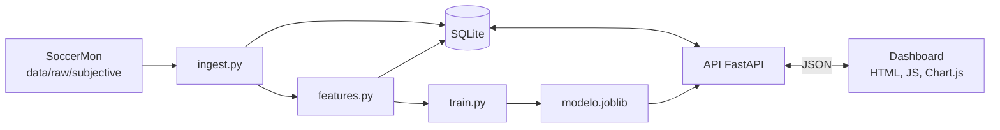

# NF3: Producto funcional en local y repositorio reproducible

> Borrador del PDF de entrega. Los marcadores `[PENDIENTE: ...]` debe completarlos el equipo. Nombre del archivo final: `NF3_Producto_Funcional_Local_y_Repositorio_NombreAlumno_Apellido1_Apellido2.pdf`. [PENDIENTE: nombre y apellidos para el archivo]

## 1. Portada

| | |
|---|---|
| **Proyecto** | AthletaGuard: Sistema Inteligente de Analítica Deportiva y Prevención de Sobrecarga |
| **Módulo** | C088. Proyecto de Inteligencia Artificial y Big Data |
| **Integrantes** | David (Project Lead & ML Engineer / Data Scientist), Iván (Backend & Data Pipeline Engineer), Arnau (Frontend Specialist & BI / UI Analyst). [PENDIENTE: apellidos] |
| **Fecha** | [PENDIENTE: fecha de entrega, como máximo 12/11/2026] |
| **Repositorio** | <https://github.com/davidillo99/AthletaGuard> |
| **Tag** | `v1.0-nf3` |
| **Commit** | [PENDIENTE: hash del commit del tag] |

### Contribuciones individuales

El enunciado pide contribuciones individuales documentadas. Esta tabla parte del historial de Git y debe confirmarla el equipo.

| Integrante | Aportación visible en el repositorio |
|---|---|
| David | Selección de datos, decisiones de tratamiento y etiqueta, y desarrollo de la entrega en la rama de NF3, con asistencia de IA (Claude Code), declarada en los commits. [PENDIENTE: confirmar] |
| Iván | Primera versión del backend y de sus pruebas (rama `feature/backend-api`, integrada y adaptada después). [PENDIENTE: confirmar y añadir revisión del PR] |
| Arnau | Estructura inicial del repositorio. [PENDIENTE: confirmar y añadir su aportación real; el dashboard entregado no procede de commits suyos] |

## 2. Estado actual del producto

**Completo**

- Ingesta, limpieza y validación de SoccerMon, con recuento de descartes.
- 21 features temporales sin datos futuros.
- Entrenamiento con validación temporal, referencias y métricas guardadas.
- API FastAPI: `POST /predict`, `GET /athletes`, `GET /athletes/{id}/history`, `GET /health`, con errores 404, 422 y 503.
- Persistencia SQLite de deportistas, sesiones, bienestar, métricas y predicciones.
- Dashboard: selector, filtro temporal, gráficos de carga, ACWR, carga semanal y bienestar, riesgo con color, símbolo y texto, histórico de predicciones y aviso no médico.
- 31 pruebas automatizadas y flujo reproducible desde un clon nuevo.

**Parcial**

- HU01: la importación de sesiones solo se hace a través del pipeline.
- HU02: tabla de las 20 últimas sesiones, sin vista de detalle.
- HU06: la evolución de HRV se sustituye por bienestar, porque el dataset no tiene HRV.
- Etiqueta: indicador de fatiga percibida, no de lesión ni de sobreentrenamiento clínico.

**Resultado del modelo en test** (01/07/2021 a 31/12/2021; 4.467 filas, 697 positivas)

| Modelo | AUC-PR | Recall | Precision | F1 |
|---|---|---|---|---|
| Dummy | 0,156 | 0,000 | 0,000 | 0,000 |
| Persistencia | 0,246 | 0,362 | 0,404 | 0,382 |
| Random Forest, alerta desde moderado | 0,470 | 0,763 | 0,279 | 0,408 |
| Random Forest, alerta solo en alto | 0,470 | 0,558 | 0,383 | 0,454 |

**Pendiente para NF4:** React, PostgreSQL, comparación con XGBoost o LightGBM, LSTM o 1D-CNN si se justifica, autenticación, `/risk`, recomendaciones de intensidad, explicabilidad, despliegue e integración continua.

## 3. Guía de ejecución local

**Requisitos previos:** Python 3.14 y Git. No hacen falta Node, Docker ni un servidor de base de datos.

**Pasos exactos en Windows (PowerShell):**

```powershell
git clone https://github.com/davidillo99/AthletaGuard.git
cd AthletaGuard
git checkout v1.0-nf3
py -3.14 -m venv .venv
.venv\Scripts\activate
python -m pip install -r requirements.txt
python -m src.pipeline.ingest
python -m src.pipeline.train
uvicorn src.backend.main:app
```

Si PowerShell bloquea la activación del entorno, ejecuta antes `Set-ExecutionPolicy -Scope Process RemoteSigned`.

**En Linux y macOS** (no se han ejecutado en estos sistemas), cambian dos pasos: `python3.14 -m venv .venv` y `source .venv/bin/activate`.

**Variables de entorno:** son opcionales, y no hay secretos. Para cambiarlas, copia `.env.example` como `.env`.

| Variable | Valor por defecto | Uso |
|---|---|---|
| `DB_PATH` | `data/processed/athletaguard.db` | Base de datos |
| `MODEL_PATH` | `models/modelo.joblib` | Modelo |
| `PORT` | `8000` | Puerto con `python -m src.backend.main`; `uvicorn` usa `--port` |

**Orden de arranque:**

1. `python -m src.pipeline.ingest`: limpia los datos, calcula las features y crea la base de datos.
2. `python -m src.pipeline.train`: entrena, evalúa y guarda el modelo.
3. `uvicorn src.backend.main:app`: arranca la API y el dashboard.
4. Abrir <http://localhost:8000> en el navegador. La API está documentada en <http://localhost:8000/docs>.

## 4. Evidencias funcionales

Las capturas siguientes proceden de una ejecución real sobre un clon limpio. [PENDIENTE: revisar o sustituir por capturas propias, y pegarlas en el PDF]

- **Front funcionando:** `docs/evidencias/01_dashboard_prediccion.png`, `docs/evidencias/04_dashboard_movil.png`
- **Backend activo:** `docs/evidencias/05_swagger.png`
- **Flujo completo** (elegir deportista → ver datos → calcular riesgo → histórico): `docs/evidencias/01_dashboard_prediccion.png`, `docs/evidencias/02_dashboard_filtro.png`
- **Gestión de errores:** `docs/evidencias/03_dashboard_error.png`
- **Pruebas automatizadas:** `docs/evidencias/pytest_resultado.txt`

## 5. Arquitectura real implementada



[PENDIENTE: renderizar el diagrama como imagen para el PDF]

Un pipeline batch limpia los datos, calcula las features y entrena el modelo. Un único servidor FastAPI lee las features de SQLite, ejecuta el modelo, guarda cada predicción y sirve el dashboard como archivos estáticos.

Coincide con las capas de NF2 §4. Las desviaciones principales, todas justificadas en `docs/arquitectura.md`, son:

| Sección de NF2 | Diseñado | Implementado |
|---|---|---|
| §4.5 Persistencia | PostgreSQL | SQLite |
| §4.6 Frontend Layer | React | HTML, JavaScript y Chart.js |
| §4.2 Feature Engineering | `variacion_hrv` | Variables de bienestar, porque SoccerMon no tiene HRV |
| §3.1 Modelos | Random Forest, XGBoost y/o LightGBM | Dummy, persistencia y Random Forest |
| §4.4 API Layer | `/risk` | Sin `/risk`, con `/health` |
| §6.2 Etiqueta | Pendiente | Fatiga percibida alta al día siguiente (Plan B de §7.3 y §13) |
| §14 Repositorio | `src/data`, `features`, `models`, `api` | `src/pipeline`, `backend`, `frontend` |

## 6. Índice de código

Árbol real del repositorio, con los datos originales resumidos:

```text
<!--ARBOL-->
```

## 7. Repositorio versionado y reproducible

| Evidencia exigida | Dónde está |
|---|---|
| Repositorio y tag o commit | <https://github.com/davidillo99/AthletaGuard>, tag `v1.0-nf3`, commit [PENDIENTE: hash] |
| README con requisitos, configuración y comandos | `README.md` |
| Dependencias | `requirements.txt`, con versiones fijadas |
| Variables de entorno sin secretos | `.env.example` |
| Pruebas y evidencia | `tests/`; resultado en `docs/evidencias/pytest_resultado.txt` |
| Estructura y módulos | `docs/estructura_repo.txt` y secciones 6 y 8 de este documento |
| Datos conforme a licencia y privacidad | `data/raw/subjective/` sin modificar; cita y licencia CC BY 4.0 en `data/raw/README.md`; identificadores anónimos |
| Artefactos | El modelo y la base de datos no se versionan: se regeneran. Sí se versionan `models/metadata.json` y `docs/experiments/` |

**Cita de los datos:** Midoglu C, Winther AK, Boeker M, et al. *A large-scale multivariate soccer athlete health, performance, and position monitoring dataset.* Scientific Data. 2024;11:553. doi:10.1038/s41597-024-03386-x. Dataset: doi:10.5281/zenodo.10033832.

**Resultado de las pruebas:** [PENDIENTE_AUTO_PYTEST]

## 8. Explicación por módulo

### Pipeline (`src/pipeline/`)

Proceso batch que prepara los datos y el modelo. Responsables según NF2 §10.3: Iván (ingesta) y David (features y modelo).

- `ingest.py`: lee los datos originales, los limpia, informa de los descartes y carga SQLite y `data/processed/`.
- `features.py`: calcula las ventanas de 7 y 28 días, el ACWR, la variación de bienestar, los días de descanso y la etiqueta.
- `train.py`: valida en orden temporal, elige hiperparámetros y umbrales, evalúa sobre el test y guarda el modelo y las métricas.

### Backend (`src/backend/`)

API que expone el modelo y los datos.

- `main.py`: punto de entrada; crea la aplicación y sirve el dashboard.
- `api.py`: endpoints; traduce los errores a códigos HTTP.
- `models.py`: esquemas Pydantic y definición de las tablas SQLite.
- `services.py`: acceso a la base de datos, carga del modelo e inferencia.

### Frontend (`src/frontend/`)

Dashboard de una sola pantalla, sin instalación ni compilación.

- `index.html`: estructura de la pantalla y aviso no médico.
- `app.js`: llamadas a la API, gráficos, tablas y mensajes de error.
- `styles.css`: estilos, incluidos los colores de riesgo.
- `chart.umd.js`: Chart.js 4.4.9, incluido para no depender de internet.

### Configuración (`src/config.py`)

Lee `DB_PATH`, `MODEL_PATH` y `PORT` del entorno o de `.env`, con valores por defecto.

### Pruebas (`tests/`)

- `test_features.py`: ventanas, ausencia de datos futuros y etiqueta.
- `test_pipeline.py`: limpieza, partición temporal, umbrales y modelo guardado.
- `test_api.py`: endpoints, errores 404, 422 y 503, y dashboard, con base de datos temporal.

### Exploración (`notebooks/`)

- `exploracion_datos.py`: reproduce las cifras con las que se decidió el tratamiento de los datos.

## 9. Limitaciones actuales

La lista completa está en `docs/limitaciones.md`. Las más importantes:

**Bugs:** no hay bugs conocidos que impidan el flujo completo. Sí hay comportamientos que pueden confundir: la fecha prevista puede ser de 2022, repetir una predicción crea otra fila, reejecutar la ingesta borra las predicciones y `uvicorn` no lee `PORT`.

**Atajos:**

- Se eliminan 76 sesiones duplicadas sin certeza de que sean dobles envíos.
- Se usa `session.json` en lugar de `daily_load.csv`, que difieren en 110 días.
- Un día sin carga se trata como descanso, salvo en rachas de 14 días o más. Ese filtro es retrospectivo.
- Se asume, sin confirmación, que un valor alto de fatiga significa "mejor".

**Partes incompletas o débiles:**

- El modelo predice fatiga percibida, no lesiones. Se descartó la lesión porque solo hay 40 episodios, 5 de ellos en el test.
- En riesgo alto, unas 6 de cada 10 alertas son falsas (precisión 0,383).
- El nivel moderado apenas informa (16,0 % de fatiga alta frente a una media de 15,6 %).
- La carga aporta el 17 % de la importancia del modelo y el bienestar, el 83 %. No se demuestra que la carga cause fatiga.
- Rinde peor en TeamB (AUC-PR 0,255) que en TeamA (0,522).
- Recall de 0,763 en test, por debajo del objetivo de 0,80.
- Población limitada: 50 futbolistas de dos equipos femeninos de élite de Noruega.
- Sin HRV, frecuencia cardíaca ni potencia.
- Solo verificado en Windows 11 con Python 3.14.

## 10. Lista de comprobación de reproducibilidad

La versión detallada está en `docs/checklist_reproducibilidad.md`.

- [ ] Repositorio accesible [PENDIENTE: confirmar acceso del docente]
- [ ] Tag o commit exacto e inmutable: `v1.0-nf3` [PENDIENTE: crear y anotar el hash]
- [x] README actualizado
- [x] Dependencias fijadas y `.env.example` sin secretos
- [x] Pruebas automatizadas con evidencia
- [x] Verificación desde un clon limpio siguiendo el README

## 11. Condiciones obligatorias

- Esta documentación corresponde al tag `v1.0-nf3`, commit [PENDIENTE: hash].
- No se modificará el código tras la entrega sin autorización para cambiar la puntuación de esta fase.
- El tag o commit y esta documentación forman la referencia oficial de corrección.
