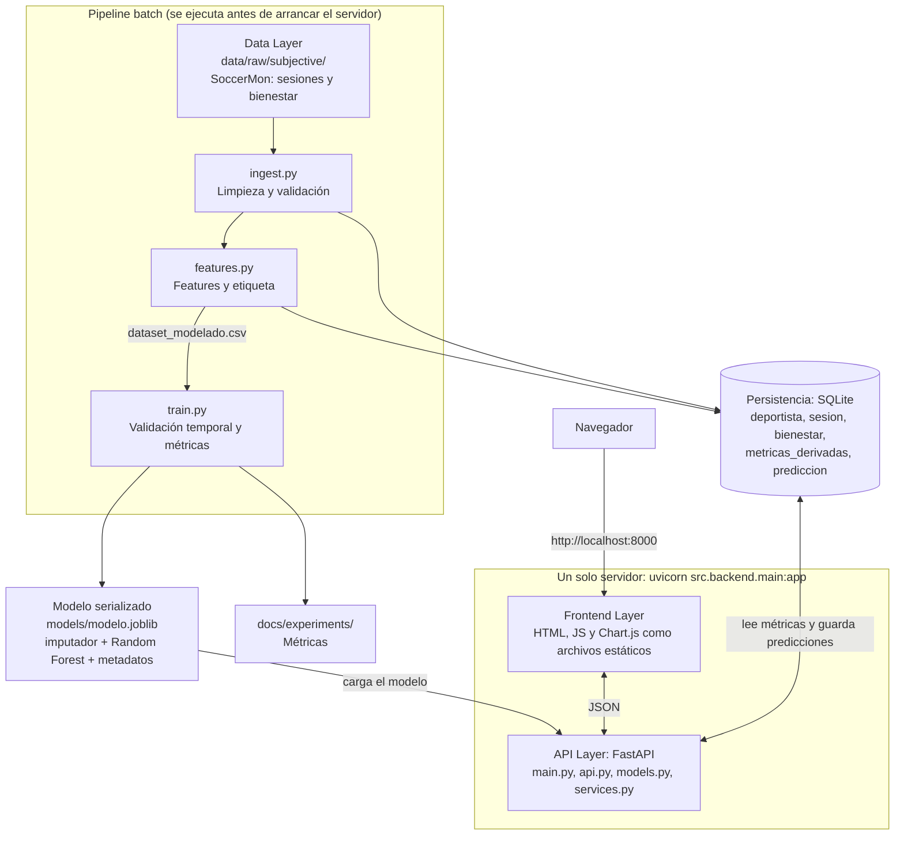

# Arquitectura real implementada

La entrega NF3 implementa las capas diseñadas en NF2 §4. Las diferencias frente al diseño son decisiones conscientes, justificadas en la tabla de este documento.

## Diagrama

## Explicación del flujo

1. **Data Layer (`src/pipeline/ingest.py`).** Lee `session.json` y los 7 CSV de bienestar. Descarta sesiones no válidas, anula valores imposibles e informa por consola de cuántas filas descarta y por qué.
2. **Feature Engineering (`src/pipeline/features.py`).** Calcula por jugadora y día 21 features: 7 de carga y 14 de bienestar. Usan solo información hasta el día t. La etiqueta es lo único que mira al futuro (t+1).
3. **ML Engineering (`src/pipeline/train.py`).** Ajusta un Random Forest con `TimeSeriesSplit` sobre fechas únicas, fija los umbrales de riesgo con predicciones fuera de muestra y evalúa una sola vez sobre el periodo de test. Guarda el imputador y el modelo juntos, con la lista de features y los umbrales.
4. **Persistencia (SQLite).** Guarda deportistas, sesiones, bienestar, métricas derivadas y predicciones.
5. **API Layer (`src/backend/`).** `POST /predict` recibe la deportista y la fecha, lee las features ya calculadas de la base de datos, ejecuta el modelo y guarda la predicción. Así la API no puede calcular features distintas a las del entrenamiento.
6. **Frontend Layer (`src/frontend/`).** Una sola pantalla servida por el propio FastAPI: selector, filtro de fechas, gráficos, riesgo con color, símbolo y texto, tablas y aviso no médico.

## Definición de la etiqueta

NF2 §6.2 dejó la etiqueta como "decisión pendiente controlada" y prohibió inventar una etiqueta clínica. Se aplica su Plan B (NF2 §7.3 y §13): reformular la salida como indicador de carga o fatiga.

- **Etiqueta:** `1` si la fatiga autoinformada del día siguiente es menor o igual que 2 (escala de 1 a 5); `0` en caso contrario. Si no hay reporte al día siguiente, la fila no se usa.
- **Niveles de riesgo:** umbrales sobre la probabilidad, fijados con datos de entrenamiento. *Moderado*: el mayor umbral con Recall de al menos 0,80 (0,376). *Alto*: el umbral de máximo F1 (0,523).
- **Por qué no la lesión real:** solo hay 40 episodios (36 en un equipo), 5 de ellos en el periodo de test, y el ACWR no los anticipa. La tasa de lesión a 7 días es 0,91 % con ACWR alto y 0,93 % con ACWR bajo.
- **Por qué no un ACWR proxy:** la etiqueta "ACWR > 1,5 hoy" es circular, porque el modelo se limita a recuperar la fórmula (AUC-PR 0,998 en el sondeo).

Las cifras se reproducen con `notebooks/exploracion_datos.py`, y su salida está en `docs/evidencias/exploracion_datos.txt`.

## Diseñado en NF2 frente a implementado

### Lo que coincide

| Sección de NF2 | Diseño | Implementación |
|---|---|---|
| §4 | Capas Data → Feature Engineering → ML → API → Persistencia → Frontend | Igual, con un módulo por capa |
| §4.2 | Carga de 7 y 28 días, ACWR, medias móviles, sesiones recientes, descanso, cambios de volumen | `carga_7d`, `carga_28d`, `acwr`, `media_movil`, `sesiones_7d`, `dias_descanso_7d`, `cambio_carga_semanal` |
| §3.1, §12 | Validación cronológica con Time Series Split | `TimeSeriesSplit` sobre fechas únicas y test temporal final |
| §12 | Recall, Precision, F1, AUC-PR, matriz de confusión | Todas, en `docs/experiments/` |
| §4.4 | `POST /predict`, `GET /athletes`, `GET /athletes/{id}/history` | Implementados |
| §6.1 | Entidades DEPORTISTA, SESION, METRICAS_DERIVADAS, PREDICCION | Tablas `deportista`, `sesion`, `metricas_derivadas`, `prediccion` |
| §4.3, §13 | Serializar el modelo y guardar el preprocesamiento junto a él | `joblib` con imputador, modelo, features y umbrales |
| §8.1 | Identificadores internos, sin datos personales | Alias como `TeamA-01`; el UUID de origen no se expone en la API |
| §8.2, HU09 | Aviso no médico visible | En el dashboard y en las respuestas de la API |
| §8.3 | Riesgo sin depender solo del color; gráficos con valores | Color, símbolo y texto; último valor junto a cada gráfico |
| §11.1 | Sin push directo a `main` | Desarrollo en la rama `feature/nf3-producto-funcional` |

### Desviaciones y su justificación

| Sección de NF2 | Diseñado | Implementado | Justificación |
|---|---|---|---|
| §3.1, §4.5, §5 | PostgreSQL como opción principal | SQLite | NF2 ya lo admite para desarrollo local. No requiere instalar un servidor, lo que facilita reproducir el proyecto desde cero |
| §3.1, §4.6, §5 | Dashboard con React | HTML, JavaScript y Chart.js, servidos por FastAPI | Sin Node ni npm: un solo servidor y un solo comando. NF3 no evalúa la estética |
| §4.6 | Vistas del dashboard con HRV | Bienestar (media de 7 días) | SoccerMon no tiene HRV |
| §3.1, §4.2, §6.1, §6.2 | `HRV`, `variacion_hrv` | Media de 7 días y variación (3 frente a 28 días) de 7 variables de bienestar | SoccerMon no tiene HRV. Se añade la tabla `bienestar` |
| §3.1, §5, §13 | Comparar Random Forest, XGBoost y/o LightGBM | Dummy, persistencia y Random Forest, con una rejilla pequeña | Prioridad a lo simple. El orden de NF2 §13.1 no llegó a exigir boosting. Se añade la persistencia para comprobar si el modelo aporta algo |
| §3.2, §13 | LSTM o 1D-CNN opcional | No se implementa | Era opcional; se deja para NF4 |
| §7.3, §13 | Pesos de clase o SMOTE | Solo `class_weight="balanced"` | Es la opción más simple de las dos previstas |
| §4.4 | `GET /athletes/{id}/risk` | No se implementa | `POST /predict` y el histórico cubren la misma necesidad |
| §4.4 | Sin `/health` | Se añade `GET /health` | Permite comprobar el estado del servicio |
| §6.1 | DEPORTISTA con `edad`, `sexo`, `nivel`, `fecha_alta` | `alias`, `equipo`, `id_origen` | El dataset no los incluye |
| §6.1, §6.2 | SESION con `tipo`, `volumen`, `fc_media`, `fc_max`, `HRV`, `potencia`, `descanso` | `fecha`, `duracion`, `rpe`, `srpe` | El dataset no los incluye. El descanso se deriva en `dias_descanso_7d` |
| §6.1 | METRICAS_DERIVADAS ligada a `id_sesion` | Ligada a `id_deportista` y `fecha` | Las ventanas son diarias: también hay métricas en días sin sesión |
| §6.1 | PREDICCION | Se añaden `fecha_objetivo` y `creada_en` | Distingue el día previsto del momento del cálculo |
| §6.2 | Etiqueta pendiente | Fatiga percibida alta al día siguiente | Ver la sección "Definición de la etiqueta" |
| §7.1 | Fuentes candidatas de Kaggle y PhysioNet | SoccerMon (CC BY 4.0) | Tiene licencia clara y series temporales por deportista. Son futbolistas, no corredoras o ciclistas |
| §11.1 | Rama `develop` y varias ramas `feature/*` | Una rama `feature/nf3-producto-funcional` | NF2 permite simplificar el flujo. Incluye el trabajo previo de `feature/backend-api` |
| §14 | `src/data`, `features`, `models`, `api`, `backend`, `frontend`; 3 notebooks; `docs/arquitectura.png` y `modelo_datos.png` | `src/pipeline`, `backend`, `frontend`; `src/config.py`; `models/` en la raíz; `notebooks/exploracion_datos.py`; `docs/arquitectura.md` | Estructura más simple, sin carpetas vacías. El script reproduce las cifras sin depender de Jupyter. El diagrama en texto se versiona mejor |
| HU01 | Importar sesiones como usuario | Solo a través del pipeline | No hay subida de archivos en esta fase |
| HU02 | Lista cronológica y detalle de sesión | Tabla con las 20 últimas sesiones del periodo, sin vista de detalle | Alcance reducido al mínimo útil |
| HU06 | Evolución de HRV | Evolución de bienestar | SoccerMon no tiene HRV |
| §11.2 | Pruebas de frontend | Comprobación manual en navegador real, sin pruebas automáticas en el repositorio | NF3 no evalúa la automatización; las pruebas automáticas cubren datos, modelo y API |
